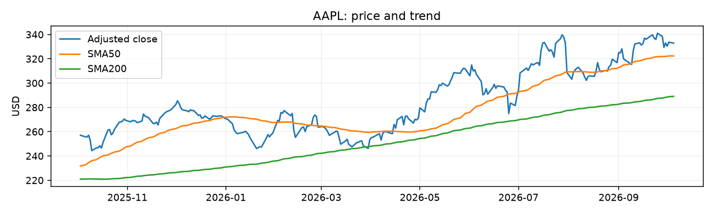

# AAPL equity research brief

As of 2026-10-05T00:00:00

## Company snapshot
Latest completed adjusted close: 332.89 USD; 52-week range: 242.76 - 345.34; P/E: 38.19; YTD: 22.78%.

## Technical outlook
Momentum: mixed. Indicators: sma_50=322.36; sma_200=289.09; rsi_14=53.81; macd=3.50; macd_signal=4.57; macd_histogram=-1.07; bb_middle=332.54; bb_upper=345.81; bb_lower=319.27

## News sentiment
Heuristic score: Unavailable; validated 0/10 headlines.
- Apple Inc. (AAPL) Stock Forecasts - Yahoo Finance (Yahoo Finance)
- Knollwood Investment Advisory LLC Trims Stock Holdings in Apple Inc. $AAPL - MarketBeat (MarketBeat)
- Apple Inc. $AAPL Shares Sold by SMART Wealth LLC - MarketBeat (MarketBeat)

## LLM recommendation
Unavailable: see warnings.

## Limitations
- LLM not executed: data-only preview

Research demonstration only, not investment advice. Data may be delayed or incomplete; LLM reasoning may be incorrect. No trading action is authorized.
